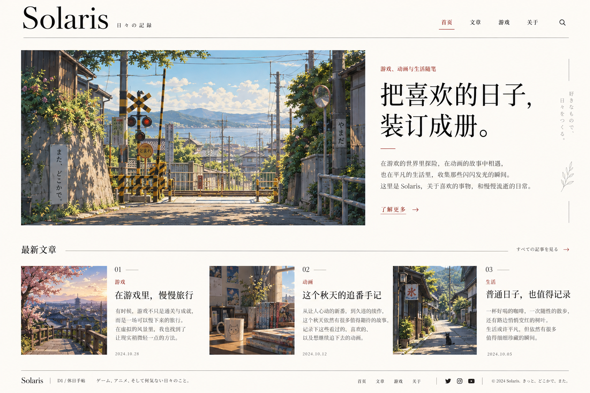

# Solaris 个人博客 PRD 与设计规范

版本：v1.1  
日期：2026-10-16（Asia/Shanghai）  
状态：首页已实现，按用户要求通过现有 GitHub Pages 工作流发布  
视觉基准：D1「休日手帖」  
项目：`bumptiouschen.github.io`

## 1. 项目定位与决策依据

Solaris 是一个记录游戏、动漫、日系文化与普通生活的个人博客。它应像一本持续更新的个人杂志：轻松、有生活感、适合阅读，也能让作者低负担地持续写作。

### 1.1 已确定的方向

- 网站名称沿用 Solaris。
- 用户选择 D1「休日手帖」作为本轮设计基准。
- 整体走简约风，内容贴近游戏、动漫和日系文化，语气轻松，不以技术能力展示为中心。
- 首页已实现，支持本地预览及 GitHub Pages 远程访问；未勾选的验收项仍需逐项确认。
- 2026-10-16 用户修订：主标题下原介绍正文改为 GitHub、X、B站图标，地址暂不配置；最新文章区独立模块化，便于频繁修改。该修订优先于原参考图。

### 1.2 本文采用的建议默认值

以下是为使方案可实施而提出的默认值，并非用户逐项确认的要求：

- 首版使用中文内容、浅色主题，以少量日文作为装饰。
- 内容分为「游戏」「动画」「生活」，日系文化相关随笔按主题归入其中。
- 沿用项目中的 Astro、Markdown 内容管理与 GitHub Pages 部署方式。
- 暂不引入登录、评论、站内搜索、内容后台和深色模式。
- 色值、字体、尺寸、断点和性能指标作为实现起点，允许在保持 D1 气质的前提下微调。

## 2. 产品目标与用户

### 2.1 产品目标

1. 初次进入时，读者能理解这是作者记录兴趣和生活的个人空间。
2. 读者能从首页或分类找到文章，并舒适地阅读长文。
3. 作者添加一篇 Markdown 文章后，列表、分类与详情能同步更新。
4. 桌面端呈现 D1 的杂志感，手机端保持清晰顺畅的阅读体验。
5. 延续免费静态托管方式，减少维护负担和对第三方服务的依赖。

### 2.2 主要使用者与路径

| 使用者 | 需要 | 主要路径 |
| --- | --- | --- |
| 初次来访的朋友或同好 | 了解作者与兴趣 | 首页 → 关于 / 最新文章 |
| 喜欢游戏、动画的读者 | 找到同类内容 | 导航或分类 → 列表 → 文章 |
| 回访读者 | 查看更新 | 首页最新文章 / 所有文章 |
| 博客作者 | 方便发布与维护 | 添加 Markdown 与图片 → 本地预览 → 构建 → 发布 |

## 3. 现有项目与改造边界

以下来自本次对仓库文件的检查，不代表线上运行状态已验证。

| 项目现状 | 本轮设计对应改造 |
| --- | --- |
| 已有首页、文章列表、文章详情、关于页 | 保留现有路径，更新布局、视觉和文案 |
| `src/content/blog/` 使用 Markdown | 延续写作方式，补充分类、封面和草稿字段 |
| 内容字段已有 `title`、`description`、`pubDate` | 保留兼容，新增字段设置合理默认值 |
| `BaseLayout.astro` 与 `public/style.css` 提供全局布局和样式 | 逐步形成 D1 的公共设计规范 |
| 首页目前展示最新 5 篇文章 | 首版改为最新 3 篇，匹配 D1 的编辑式布局 |
| 文案目前偏技术、开发与学习记录 | 页面介绍调整为游戏、动画与生活；已有文章正文不自动改写 |
| `astro.config.mjs` 配置了站点地址 | 沿用 `https://bumptiouschen.github.io/` |
| 已有 GitHub Actions 部署工作流 | 沿用，实际部署状态在实现阶段验证 |

本轮实现不应因视觉重设计而重新初始化项目、升级依赖或更换部署平台；如确有需要，应单独说明原因。

## 4. 需求范围与优先级

P0 为首版交付必须满足的要求；P1 为后续增强项，不计入首版验收。

| 编号 | 优先级 | 需求 | 完成定义 |
| --- | --- | --- | --- |
| F01 | P0 | 全站导航与页脚 | 首页、文章、游戏、关于入口有效；当前栏目可识别 |
| F02 | P0 | D1 风格首页 | 品牌栏、主视觉、个人介绍、最新 3 篇文章与页脚完整 |
| F03 | P0 | 所有文章 | 按发布日期倒序展示全部公开文章，可进入分类与详情 |
| F04 | P0 | 三类内容页 | 游戏、动画、生活各自展示对应文章，空状态明确 |
| F05 | P0 | 文章阅读页 | 标题、摘要、日期、分类与 Markdown 正文正常展示 |
| F06 | P0 | 关于页 | 简要说明作者兴趣与博客定位，联系入口按真实资料配置 |
| F07 | P0 | 内容发布规则 | 草稿和未来文章不进入公开列表或生成公开详情页 |
| F08 | P0 | 响应式与无障碍基础 | 手机到桌面无页面级横向溢出，键盘可完成主要操作 |
| F09 | P0 | 元信息与错误页 | 每页有合适的标题与描述，未知路径有返回入口 |
| F10 | P1 | 站内搜索 | 在文章规模增加后提供标题、摘要或正文搜索 |
| F11 | P1 | 阅读增强 | 长文目录、上一篇 / 下一篇、RSS、站点地图 |
| F12 | P1 | 主题与互动 | 另行设计深色主题、评论或订阅能力 |

首版不设置账号系统、点赞计数、虚构阅读量、付费服务、自动播放音乐、复杂背景特效、游戏资料数据库或追番进度后台。

## 5. 信息架构与路径

| 页面 | 路径 | 入口与说明 |
| --- | --- | --- |
| 首页 | `/` | 品牌名称、主导航「首页」 |
| 所有文章 | `/posts/` | 主导航「文章」、首页「查看全部文章」 |
| 文章详情 | `/posts/{slug}/` | 文章标题、封面；保留已有文章地址 |
| 游戏分类 | `/categories/game/` | 主导航「游戏」、分类入口 |
| 动画分类 | `/categories/anime/` | 列表分类入口、文章分类链接 |
| 生活分类 | `/categories/life/` | 列表分类入口、文章分类链接 |
| 关于 | `/about/` | 主导航「关于」、首页「了解更多」 |
| 未找到页面 | `/404.html` | 未知路径；提供首页和文章列表入口 |

首版主导航为「首页 / 文章 / 游戏 / 关于」。动画和生活通过文章列表分类访问，避免导航过长。

- 文章与分类切换采用普通链接，即使没有 JavaScript 也可使用。
- 文章详情统一归属导航「文章」；游戏分类页高亮「游戏」，其他分类页高亮「文章」。
- 已存在文章链接保持稳定。首版 Markdown 文件采用平铺目录与唯一文件名，暂不新增多层目录 slug 规则。

## 6. 页面设计与行为

### 6.1 首页

从上到下包含以下区域：

1. **品牌与导航**：左侧大号衬线 Solaris，搭配小字「日々の記録」；右侧导航，下面用细线分隔。
2. **主视觉区**：桌面左侧约 60% 为日系生活风景插画，右侧约 40% 为标题、GitHub / X / B站图标与「了解更多」链接。社交地址为空时仅显示带名称提示的图标。画面优先选晴天街道、铁道口、海边或普通生活场景。
3. **最新文章区**：左侧标题「最新文章」，右侧「查看全部文章 →」。桌面排列 3 个条目，以小图、编号、分类、标题、摘要和日期组成；采用留白与排版区分条目。
4. **页脚**：细分隔线、Solaris、短句、导航与真实配置的社交链接。

建议首页主标题：

> 把喜欢的日子，装订成册。

原建议介绍已从首页移除，可供关于页后续选用：

> 在喜欢的世界里探险，在动画的故事中相遇，也在平凡的生活里，收集那些闪闪发光的瞬间。这里是 Solaris，记录喜欢的事物，和慢慢流逝的日常。

「了解更多 →」进入关于页，避免使用营销式大按钮。

行为与边界：

- 最新文章按发布日期倒序，同一天以稳定 slug 顺序排序；允许在 `src/config/home.ts` 配置优先文章顺序，其他位置按日期补齐。最多展示 3 篇，不强行凑齐分类。
- 文章区由 `LatestArticles.astro` 与 `ArticlePreview.astro` 组成。文案、封面和日期来自 Markdown，标题、数量与优先顺序集中配置，便于频繁修改。
- 本地预览允许展示明确标注的排版示例；`src/config/site.ts` 的 `showSamples` 开关统一控制它们在列表和详情路径中的可见性。
- 只有 1～2 篇时按实际数量展示，保持左对齐，不复制文章、不添加虚构内容。
- 没有公开文章时显示「第一篇记录，还在路上。」并保留关于入口。
- 序号 01～03 表示首页展示顺序，不是永久文章编号。
- 封面和标题均能进入文章；摘要可限制为 3 行，标题允许换行且不截断关键信息。

### 6.2 所有文章与分类页

- 页面标题、简短说明、分类链接和文章列表依次排列。
- 分类入口使用「全部 / 游戏 / 动画 / 生活」，当前分类通过文字样式和下划线共同标记。
- 条目包括分类、标题、日期、摘要与可选缩略图；采用细线和留白，延续首页风格。
- 首版不分页，按时间倒序输出所有公开文章；文章数量达到影响阅读或加载体验时再增加分页。
- 空分类显示「这一页还在慢慢积累。」与「看看其他文章」入口，不显示无效内容卡片。

### 6.3 文章详情

- 顶部提供「← 所有文章」，然后是分类、标题、日期和摘要。
- 可选封面位于正文之前；无封面时直接进入正文，不留空白占位。
- 正文保持窄阅读栏，支持标题、段落、链接、列表、引用、图片、表格和代码块。
- 正文图片保持比例，可附图注；表格和代码块在自身容器内横向滚动。
- 正文结束提供返回文章列表与所属分类的入口。
- 超长标题可自然换行；不采用固定高度裁切正文标题。
- 首版不显示未经实现的阅读量、评论数或估算阅读时长。

### 6.4 关于页与 404

- 关于页使用简短自我介绍、兴趣主题和博客说明，避免履历式技能展示。
- 作者昵称暂沿用 Solaris；头像、具体喜爱的作品、社交账号等不根据设计图推定。
- 未提供真实地址的社交入口直接隐藏，不使用 `#` 或无效链接占位。
- 404 页用简洁文案说明页面不存在，提供「回到首页」「看看文章」链接。

## 7. D1 视觉规范

### 7.1 参考图与使用原则



此图是本项目的视觉方向参考。图中的文章、日期、社交图标及日文装饰是示例，不作为真实内容或已确定功能。

应保留：米白底色、深色衬线标题、极少量暗红强调色、宽松留白、日系生活主视觉、细线分隔和杂志式图文关系。

实现时用真实 HTML 文本和组件重建页面，不将整张参考图作为网页背景；插画需提供独立原始素材，不能从含文字的页面截图裁切充当最终资源。

### 7.2 颜色建议

| 角色 | 建议色值 | 用途 |
| --- | --- | --- |
| 页面背景 | `#FAF8F3` | 温暖的米白底色 |
| 主文字 | `#24221F` | 标题与正文 |
| 次级文字 | `#666058` | 摘要、日期、辅助说明 |
| 强调色 | `#9B352B` | 分类、当前导航、少量文字链接 |
| 分隔线 | `#D8D2C8` | 非交互区域边界 |
| 悬停浅底 | `#F0EBE2` | 必要的交互反馈 |

色值是建议设计令牌，实际前景与背景组合需验证对比度。分隔线色不承担关键控件边界或文字信息。

### 7.3 字体与排版

- Solaris 品牌使用优雅的拉丁衬线字体；中文标题优先选择有宋体气质的衬线字体。
- 正文优先采用易读的中文字体，可用系统字体作为首版回退；避免为了风格加载过大的完整中文字体包。
- 拉丁品牌可从 Georgia 等系统衬线字体开始，中文标题可用 Noto Serif SC / Source Han Serif SC 等候选；使用外部字体前确认许可与加载方式。
- 正文建议 17～18px、行高 1.8～1.9；辅助信息不低于 13px，移动端正文不低于 16px。
- 桌面首页主标题建议 44～56px，手机端 30～36px；字号按实际中文换行效果调整。
- 正文最大宽度约 720px，不沿用首页宽栏阅读长文。
- 日文仅用于少量装饰；关键导航、操作、分类和提示使用中文。

### 7.4 布局、间距与图片

- 桌面内容容器最大宽度建议 1360px，左右留白至少 32px；手机左右留白 20px。
- 间距以 8px 为基础尺度，常用 8 / 16 / 24 / 32 / 48 / 64px。
- 桌面主要区块间距建议 56～72px，手机端 32～40px。
- 主视觉图片以约 2:1 的横向比例为起点；首页条目采用约 3:4 的竖向缩略图，保留裁切焦点配置空间。
- 图片以直角为主，不采用明显的大圆角、悬浮阴影和玻璃效果。
- 长标题、无图文章和不足 3 篇文章均需保持布局自然，不能依赖固定示例文本长度。

### 7.5 动效与交互反馈

- 导航通过文字颜色、下划线和焦点轮廓提供反馈；颜色不是唯一状态提示。
- 悬停反馈可使用 150～200ms 的轻微过渡，不引入滚动劫持、首屏遮挡动画或持续漂浮装饰。
- 遵循减少动态效果的系统偏好；触屏无需悬停也能理解和操作。

## 8. 响应式与无障碍要求

| 屏幕范围 | 推荐布局 |
| --- | --- |
| ≥ 1024px | 桌面品牌导航；主视觉左右双栏；首页最新文章三列 |
| 768～1023px | 缩小品牌和主标题；主视觉可改为上下排列；文章列表两列 |
| < 768px | 品牌与导航分行；主视觉按图片、介绍顺序排列；文章单列 |

- 手机端保留四个可见导航入口，空间不足时自然换行，不默认增加折叠菜单。
- 在 320、375、768、1024、1440px 宽度下检查页面，不出现页面级横向滚动。
- 交互触控区域建议至少 44×44px；链接可通过内边距增加点击范围。
- 使用清晰的标题层级、导航语义、单一页面主标题和可见键盘焦点，提供跳转正文入口。
- 普通文字对比度目标至少 4.5:1，大字至少 3:1；上线前以实际组合检测。
- 内容图片提供有意义的替代文本；纯装饰图使用空替代文本。
- 浏览器缩放至 200% 后内容和主要操作保持可用；不要以固定高度裁切文本。

## 9. 内容模型与发布规则

### 9.1 文章字段

| 字段 | 要求 | 说明 |
| --- | --- | --- |
| `title` | 必填 | 文章标题，沿用现有字段 |
| `description` | 必填 | 列表摘要与页面描述，沿用现有字段 |
| `pubDate` | 必填 | 发布日期，格式 `YYYY-MM-DD` |
| `category` | 可选，默认 `life` | 枚举 `game` / `anime` / `life`，一篇文章一个主分类 |
| `cover` | 可选 | 本地封面资源地址 |
| `coverAlt` | 有内容性封面时必填 | 描述画面内容，避免仅写“封面” |
| `draft` | 可选，默认 `false` | 为 `true` 时不公开 |

示例仅用于说明格式，不代表需要创建这篇文章：

```yaml
---
title: "在游戏里，慢慢旅行"
description: "暂时放下任务清单，记录一次在游戏世界里的散步。"
pubDate: 2026-10-16
category: game
cover: /images/posts/game-walk.webp
coverAlt: "旅行者站在山坡上，望向远处的小镇与群山"
draft: true
---
```

### 9.2 内容行为

- 原有仅含三个字段的文章必须继续通过内容校验；没有分类时归入生活，原有地址保持不变。
- 公开条件统一为 `draft !== true` 且发布日期不晚于构建时上海时区的日期。
- 发布日期按日历日期处理，避免时区转换导致日期显示提前或延后一天。
- 首页、所有文章、分类页和文章详情的静态路径生成必须共用相同公开条件。
- 未来日期的文章只有在达到日期并重新构建后才会出现；首版不承诺自动定时发布。
- 日期相同时按稳定 slug 排序，避免不同页面顺序变化。
- 无封面时允许纯文字条目；缺失图片应有可读回退，不能使布局崩溃。
- 草稿仍保存在仓库中；若仓库公开，草稿文件可被访问。草稿标记仅控制站点发布，不用于保存秘密内容。

### 9.3 素材与文案

- D1 参考图随本文保存于 `docs/design/references/`，供设计和开发对照。
- 生产用主视觉、封面与头像需单独准备，可使用自制、获授权或生成素材；记录素材来源。
- 不将概念图里的阅读量、日期、社交账号、具体作品偏好当作作者资料。
- 保持已有真实文章内容，页面介绍的调整不等于授权重写文章正文。

## 10. 工程与质量要求

### 10.1 实现原则

- 使用现有 Astro 项目输出静态站点；首版核心阅读和导航不依赖客户端 JavaScript。
- 公共头部、页脚、文章条目与分类入口复用，避免各页面出现不同的间距和状态规则。
- 使用全局设计令牌维护颜色、字号、容器宽度与间距。
- 根据显示尺寸输出适当分辨率的图片，提供宽高信息减少布局跳动；首屏主视觉优先加载，屏外文章图延迟加载。
- 本地已有资源应优先复用，不为视觉改造添加不必要的运行时框架。

### 10.2 元信息、性能与发布

- 每页设置中文语言、独立标题、描述、canonical 与基础分享元信息；不要残留默认技术博客介绍。
- 首屏主视觉压缩后以不超过约 300KB 为目标，首页总图片传输体积以不超过约 800KB 为目标；画质与实际网络测试共同决定最终资源。
- 移动端实验室测试目标：LCP ≤ 2.5s、CLS ≤ 0.1；记录工具版本、设备与网络模拟条件，作为开发目标而非当前测量结果。
- 公共页面和静态资源不应出现 404；检查文章直接访问与刷新、分类路由、社交外链以及自定义 404。
- 构建沿用 `npm.cmd run build`；发布沿用现有 Actions 工作流。设计稿交付不触发代码实现或发布。

## 11. 验收清单

以下清单在实现阶段逐项验证，本次文档交付不勾选。

### 11.1 视觉与体验

- [ ] 桌面首页保留 D1 的米白底色、衬线标题、暗红点缀、主视觉双栏与最新文章三列关系。
- [ ] 与参考图对照时，布局比例和气质一致；不要求复制示例文字、日期和未配置的社交图标。
- [ ] 手机端主视觉和文章自然堆叠，导航可读且可点击。
- [ ] 首页只有 0、1、2、3 篇文章时均正常；长标题与无封面文章无溢出。
- [ ] 键盘焦点可见、图片替代文本正确、200% 缩放可用、实际文字对比度符合目标。

### 11.2 功能与内容

- [ ] 所有导航、文章标题、封面、分类和返回链接均进入正确页面。
- [ ] 所有列表均按统一日期与 slug 规则排序；首页最多显示 3 篇。
- [ ] 草稿与未来文章同时从首页、列表、分类页和生成的详情页排除。
- [ ] 原有文章在不添加新字段的情况下仍可构建、访问和阅读。
- [ ] 空分类、404、缺失图片与超长正文有合理表现。
- [ ] 关于页和页脚没有虚构账号、失效占位链接或未经确认的个人信息。

### 11.3 工程验证

- [ ] `npm.cmd run build` 成功；本地预览检查无关键资源加载错误。
- [ ] 在约定宽度下留存首页、列表和文章页截图进行视觉复核。
- [ ] 检查桌面浏览器和至少一个移动端浏览环境，记录发现与修复结果。
- [ ] 实测图片体积和主要性能指标，记录结果与未达标原因。
- [ ] 在实际发布阶段确认 GitHub Actions 成功、线上路由和资源正常。

## 12. 建议实施顺序

| 阶段 | 交付内容 | 退出条件 |
| --- | --- | --- |
| 1. 视觉基础与首页 | 设计令牌、公共布局、独立主视觉、D1 首页 | 桌面与手机首页可预览并与参考图对照 |
| 2. 阅读与分类 | 列表、分类、文章、关于和 404 | 主要阅读路径完整，内容规则一致 |
| 3. 内容与质量整理 | 真实文案和素材、无障碍、资源优化、边界状态 | P0 验收通过并记录验证结果 |
| 4. 发布验证 | 通过现有流水线部署并检查线上结果 | 站点地址、路由和资源正常 |

## 13. 后续需要补充的资料

这些项目不阻塞使用本文开始制作首版预览，但上线时应采用真实内容或按规则隐藏：

| 资料 | 暂定处理 |
| --- | --- |
| 作者昵称、个人介绍 | 昵称沿用 Solaris；介绍使用本文建议文案 |
| 头像、主视觉与文章封面 | 单独准备素材，D1 参考图仅作布局参考 |
| 游戏、动画的具体偏好与首批文章 | 不预设为作者真实喜好；已有文章继续保留 |
| GitHub、B站、邮箱等联系地址 | 未提供的入口隐藏 |
| 是否增加搜索、评论、深色模式 | 保留为 P1，待首版体验稳定后另行确定 |

后续调整若涉及布局方向、首版范围或内容模型，应同步更新本文版本及相应验收项。
